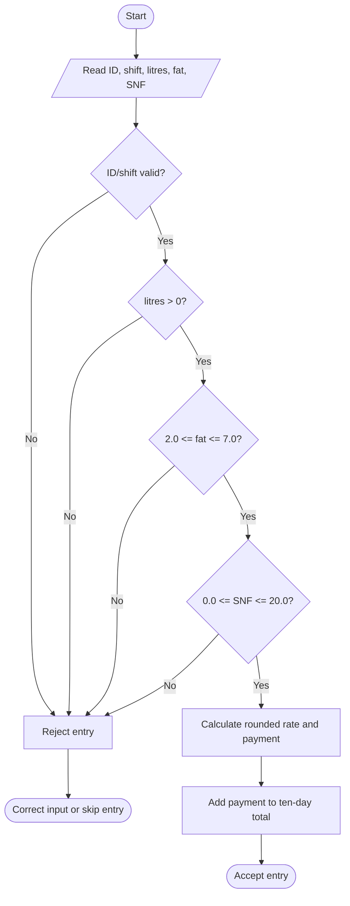
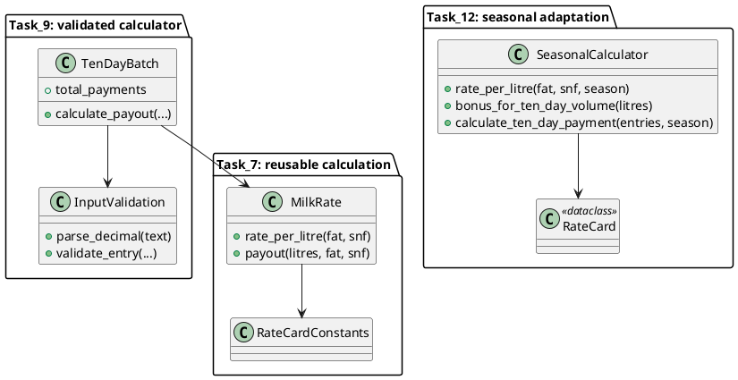

# CSA0805-1924260165-Assignment1

**Student:** Dev Narayan E  
**Register number:** 1924260165  
**Python:** 3.15  
**Dependencies:** Python standard library only; see `requirements.txt`.

## Task 1 – Understand the problem and identify the data

Each collection entry needs a farmer ID (`str`), litres (`Decimal`), fat
percentage (`Decimal`), SNF percentage (`Decimal`) and shift (`str`). Farmer ID
and shift identify the record; decimal values represent measurements and
money without binary floating-point error. A ten-day record also needs an
entry date or collection-day identifier if historical records are retained.
Entry count and loop indexes are whole-number `int` values.

The program computes the number of 0.1% fat and SNF increments, a rate per
litre, the payment for each accepted entry, and the sum of payments for the
farmer's ten-day period. The base rate is Rs 30.00 at 3.5% fat and 8.5% SNF.
Each 0.1% fat increment changes the rate by Rs 0.40; each 0.1% SNF increment
changes it by Rs 0.30. Named rate and validation constants are in
`Task_1/task1.py` and are centralized for later tasks.

Rules and assumptions:

* Quantity must be positive. A zero or negative delivery is not payable.
* Fat is accepted from 2.0% through 7.0%, inclusive, following the assignment's
  stated example.
* SNF is assumed to be from 0.0% through 20.0%, inclusive; the assignment
  specifies no SNF limits, so this broad physical/operational validation range
  is an explicit assumption to prevent impossible values.
* Shift is either morning or evening. Farmer ID must not be empty.
* Quality increments are rounded to the nearest 0.1% step using decimal
  `ROUND_HALF_UP`. Rate is rounded to two decimal places, then each entry's
  payout is rounded to the nearest paisa using `ROUND_HALF_UP`.
* Ten-day totals add already-rounded entry payments. The stated requirement is
  payment correctness to the paisa; the assignment does not specify a different
  bank rounding convention.

For 300 records, separate names such as `litres1`, `fat1`, `snf1` through
`litres300` are technically O(n) storage and O(n) processing, but require
manually writing and changing hundreds of names. A list of records (or
tuples) is also O(n) storage and O(n) processing, but lets one loop handle any
count and preserves the relationship between each farmer's values. If only a
running total is required, streaming records reduces extra storage to O(1).
Thus the data structure does not improve the asymptotic bound versus separate
variables, but makes the implementation maintainable and scalable.

## Task 2 – Explore values and types

Interactive evidence:

```pycon
>>> type(10)
<class 'int'>
>>> type(10.0)
<class 'float'>
>>> type("10")
<class 'str'>
>>> type(True)
<class 'bool'>
>>> type([10, 8.5])
<class 'list'>
>>> 7 / 2
3.5
>>> 7 // 2
3
>>> 7 % 2
1
>>> -7 // 2
-4
>>> 0.1 + 0.2 == 0.3
False
>>> Decimal("0.1") + Decimal("0.2") == Decimal("0.3")
True
```

`/` returns a floating-point quotient. `//` floors toward negative infinity,
which is why `-7 // 2` is -4 rather than -3. `%` gives the remainder consistent
with floor division. Binary floats store approximations of many decimal
fractions, so the sum of the approximations of 0.1 and 0.2 is not exactly the
approximation of 0.3.

The completed program `Task_2/task2.py` prints float total `33400.30000000061`
for 1,000 payments of Rs 33.40 plus three Rs 0.10 amounts, while the exact
Decimal total is `33400.30`. The observed `sys.getsizeof` values on this Python
3.15 runtime were 28 bytes for the resulting integer-paise value, 24 bytes for
the float total, and 120 bytes for the Decimal total. These are individual
object sizes for this build, not total list/record storage. Integer paise is
exact when every value is already expressible in whole paise; Decimal is more
general when a product needs rounding. Applying `round()` after each float
addition happens to give `33400.3` for this sample but does not make binary
floating-point arithmetic a general exact-money representation.

`Decimal("0.1")` creates the intended exact decimal. By contrast,
`Decimal(float("0.1"))` prints
`0.1000000000000000055511151231257827021181583404541015625`: the float's
binary approximation is converted exactly into a long decimal expansion.
Convert from input text, not from a float.

Complexity: summing n payments is O(n) time. A streaming sum uses O(1)
additional space; storing all input payment strings uses O(n). Integer paise,
float, and Decimal addition each have constant-time behavior for the fixed
precision and magnitudes in this application; Decimal objects consume more
memory, but the demonstrated exactness justifies it.

## Task 3 – Choose variables and name constants

`Task_3/task3.py` uses `snake_case` for variables and `UPPER_CASE` for
constants. Python does not enforce constants; uppercase is a convention that
communicates that a value should not be reassigned. A variable can refer to
values of different types at different times (`value = 10`, then
`value = "ten"`), because Python is dynamically typed. Multiple assignment
initializes several names at once, and `left, right = right, left` swaps values
without a temporary variable.

Embedding rates as magic numbers means a revision must locate and change k
expressions. Constants reduce this to one change per rate. A dictionary such
as `RATE_CARD = {"base": ..., "fat_step": ..., "snf_step": ...}` can group the
same values and allow lookup, but makes the access slightly more indirect.
Either design has O(1) lookup and O(1) storage for a fixed rate card; the
important improvement is reducing revision errors, not asymptotic runtime.

## Task 4 – Write correct expressions

For each quality, calculate
`(measurement - standard) / Decimal("0.1")`, round the result to the nearest
whole increment with `ROUND_HALF_UP`, and multiply by the corresponding
per-step amount. Add both adjustments to the base rate. Multiply the rate by
litres and quantize the result to `Decimal("0.01")`. Parentheses make the
intended subtraction, division and rounding order explicit.

Observed surprises in `Task_4/task4.py`:

* `(4.2 - 3.5) / 0.1` using floats gives `7.000000000000002`, not exactly 7.
  Decimal input and explicit step rounding avoid counting the wrong step.
* `0.1 + 0.2 == 0.3` is `False` for floats for the binary representation
  reason above.
* `-7 // 2` is `-4`, since floor division rounds down.
* `int(-3.9)` is `-3` (truncation toward zero), while `math.floor(-3.9)` is
  `-4`. `round(2.5)` and `round(-2.5)` give 2 and -2 because Python's built-in
  `round` uses ties-to-even.
* `-2 ** 2` is -4 because exponentiation binds more tightly than unary minus;
  `(-2) ** 2` is 4. `2 ** 3 ** 2` is 512 because exponentiation associates
  from the right.

With fat alone adjusted and the base rate Rs 30.00, fat 4.2 has seven steps:
`int` and `floor` both give Rs 32.80. Fat 3.1 is four tenths below standard:
`int(-3.999...)` truncates toward zero to -3 and gives Rs 28.80, while
`floor` gives -4 and Rs 28.40. Nearest-step rounding also gives -4 and Rs
28.40. This shows why truncation is not the required rule. Each arithmetic
variant is O(1) time and O(1) space.

Chained comparison `2.0 <= fat <= 7.0` means both range checks must be true;
combine it with the SNF and quantity checks using `and`. Operator precedence
and explicit parentheses keep calculation and validation intent clear.

## Task 5 – Read input and convert types

`input()` always returns text. Convert a numeric field to Decimal after
stripping whitespace. `" 8.5 "` is accepted; `"8,5"` and `"eight"` are not
valid Python decimal syntax and are rejected with an explanatory message.
The program uses conversion inside `try/except`, rather than attempting to
recognize every valid decimal with string methods. A float-based alternative
is `try: value = float(text)` / `except ValueError: ...`, but the accepted
syntax and later arithmetic should still be controlled. Both approaches do
O(m) work for an input string of length m, which is constant for ordinary
entry fields. Conversion exceptions report invalid input more precisely than
fragile character tests.

`Task_5/task5.py` reads ID, shift, quantity and analyser values and prints
aligned columns with f-string widths and two-decimal precision. Its sample
input and captured run are in `Task_5/sample_input.txt` and `Task_5/output.txt`.

## Task 6 – Organise logic into functions

`Task_6/task6.py` defines `rate_per_litre(fat, snf)`, `payout(litres, fat,
snf)` and `ten_day_total(entries)`, with docstrings and returned Decimal
values. Helpers convert values and compute quality steps. A returned value is
usable by other functions or callers; printing is only a side effect and
cannot replace a value needed for further calculations.

Rate constants are module-level names read by functions. Functions do not
assign to those names, so they remain global constants by convention; local
names hold temporary values and do not leak into callers. A single long script
could perform the same calculation, but would repeat formulas and couple
calculation to display. Lambdas are useful for small expressions, not a
replacement for named, documented multi-step logic. A rate or payout is O(1);
totaling n entries is O(n) time and O(1) extra space. Calls add constant
overhead per entry and do not change the O(n) bound.

## Task 7 – Build a module

`Task_7/milkrate.py` contains the rate card and calculation functions.
`Task_7/task7.py` imports it as `mr` and calls `mr.payout(...)`.
`import milkrate` keeps names qualified by the module;
`from milkrate import payout` binds `payout` directly in the importing
namespace; `import milkrate as mr` uses the shorter alias.

The `if __name__ == "__main__":` block runs sample output only when the file
is executed directly. On import, Python sets the module's `__name__` to
`"milkrate"`; therefore, the guarded table does not print. Removing the guard
would run that table on every first import. Python searches the importing
script's directory and entries in `sys.path`. The module uses the standard
`decimal` library to preserve money arithmetic; no third-party dependency is
needed. Python caches imported modules in `sys.modules`, so a repeated import
within a process does not repeat the initial module execution.

Copying each rate function into every consumer would avoid module lookup but
would require editing every copy for a seasonal change and risks inconsistent
rates. A module has a one-time import and execution cost per process, then
provides shared functions and one source of truth.

## Task 8 – Plan the algorithm before coding

Problem-solving sequence: understand the payment and validation rules; plan
the calculation and storage; implement the plan; test normal, boundary and
invalid cases.

SIMATS-style pseudocode:

```text
BEGIN
    SET total_payment <- 0.00
    SET entry_count <- number of collection entries
    FOR each entry from 1 through entry_count
        READ farmer_id, shift, litres, fat, snf
        IF farmer_id is empty OR shift is invalid
           OR litres <= 0 OR fat < 2.0 OR fat > 7.0
           OR snf < 0.0 OR snf > 20.0 THEN
            DISPLAY "Invalid entry"
            CONTINUE to next entry
        ENDIF
        SET fat_steps <- ROUND_HALF_UP((fat - 3.5) / 0.1)
        SET snf_steps <- ROUND_HALF_UP((snf - 8.5) / 0.1)
        SET rate <- 30.00 + fat_steps * 0.40 + snf_steps * 0.30
        SET payment <- ROUND_HALF_UP_TO_PAISE(litres * rate)
        SET total_payment <- total_payment + payment
        DISPLAY farmer_id, rate, payment
    ENDFOR
    DISPLAY total_payment
END
```

Validation flowchart:



Hand trace from `Task_8/task8.py`:

| Entry | Litres | Fat | SNF | Rate (Rs/L) | Payment (Rs) | Running total (Rs) |
|---:|---:|---:|---:|---:|---:|---:|
| 1 | 10 | 3.5 | 8.5 | 30.00 | 300.00 | 300.00 |
| 2 | 8.5 | 4.2 | 8.7 | 33.40 | 283.90 | 583.90 |
| 3 | 12 | 3.1 | 8.3 | 27.80 | 333.60 | 917.50 |

Storing all n records then summing uses O(n) time and O(n) space. Updating a
running total as each validated entry arrives also uses O(n) time but O(1)
extra space. Store records when audit history, correction, reporting, or
recalculation is needed; otherwise stream into the total.

## Task 9 – Implement and test the calculator

`Task_9/calculator.py` validates inputs, computes Decimal rates and entry
payments, and produces a ten-day running total. Run the assert suite with
`python Task_9\test_task9.py`; run the five-entry demonstration using the
provided `Task_9/sample_input.txt`.

| Test case | Expected | Actual | Result |
|---|---:|---:|---|
| Standard fat/SNF rate | Rs 30.00 | Rs 30.00 | Pass |
| Fat and SNF above standard | Rs 33.40 | Rs 33.40 | Pass |
| Fat and SNF below standard | Rs 27.80 | Rs 27.80 | Pass |
| Minimum allowed fat, 2.0% | Rs 24.00 | Rs 24.00 | Pass |
| Maximum allowed fat, 7.0% | Rs 44.00 | Rs 44.00 | Pass |
| Standard 10 L payout | Rs 300.00 | Rs 300.00 | Pass |
| Five entries, hand-calculated total | Rs 1,345.50 | Rs 1,345.50 | Pass |
| Trimmed numeric string `" 8.5 "` | 8.5 | 8.5 | Pass |
| Text `"eight"` and comma `"8,5"` | Reject | Rejected | Pass |
| NaN and Infinity | Reject | Rejected | Pass |
| Negative litres | Reject | Rejected | Pass |
| Fat 1.9% and 7.1% | Reject | Rejected | Pass |

The five payments are Rs 300.00, Rs 283.90, Rs 333.60, Rs 120.00 and Rs
308.00. `test_task9.py` asserts every expected value and invalid-input outcome;
`Task_9/test_output.txt` records the results. Re-running an assert test suite
after a change takes one command and consistently covers the same cases.
Typing cases by hand can be useful for UX, but makes repeat testing slower and
more error-prone as the test count grows.

## Task 10 – Compare expectations with execution

`Task_10/task10.py` uses a seeded data set with a mix of the three quality
pairs and five litre quantities, and measures with `time.perf_counter()`. This
is one measured run on the current Python 3.15 Windows environment; timings
vary by machine and load.

| Entries | Decimal total | Float total (2 d.p.) | Raw float error | Decimal time | Float time |
|---:|---:|---:|---:|---:|---:|
| 300 | Rs 70,576.50 | Rs 70,576.50 | 1.455192e-11 Rs | 0.000536 s | 0.000397 s |
| 6,000 | Rs 1,366,451.84 | Rs 1,366,451.84 | 1.871027e-8 Rs | 0.010621 s | 0.007522 s |
| 150,000 | Rs 34,519,658.44 | Rs 34,519,658.44 | 2.036005e-5 Rs | 0.284472 s | 0.196986 s |

The experiment's float totals happen to format to the same paisa, but the raw
accumulation error grows with volume and is non-zero. The separate Task 2
experiment also demonstrates a float total of
`33400.30000000061` where the exact total is `33400.30`. A matching displayed
total on one data set is not proof that floats are safe for the bank ledger.

For five entries paying Rs 0.155 each, rounding each entry to paisa yields
Rs 0.16 × 5 = Rs 0.80. Summing unrounded amounts first gives Rs 0.775 and
rounding once gives Rs 0.78. The implementation follows the per-entry
rounding rule so every posted farmer payment is itself an exact paisa amount;
the union's bank transfer is the sum of those posted amounts.

The same 150,000-entry data was measured with and without a dictionary of
rates: three unique (fat, SNF) pairs gave the same Rs 34,519,658.44 total;
the measured uncached time was 0.289860 s and cached time was 0.088868 s.
Rate calculation is constant time. Dictionary lookup is average O(1) per
entry; storing k distinct pairs costs O(k) additional space. The measured
uncached time was 0.281852 s and cached time was 0.085699 s. This benefit
depends on pair reuse and should be remeasured if analyser readings vary
continuously.

## Task 11 – Recommend and defend the final design

Use `Decimal` constructed from input strings, named rate-card constants,
validation functions, a module boundary, and explicit rounding to the nearest
paisa for each farmer entry. The measurement supports the choice: at 150,000
entries the float summation accumulated about Rs 0.00002036 of raw error,
while Decimal remained exact; the output remains sub-second in this measured
simple in-memory run. Seasonal changes should update one validated rate card,
not several formulas.

At district-union scale, a single-process in-memory demonstration is not a
complete production architecture. Use a database with indexed farmer and
date keys, transactional payment batches, durable audit records, idempotent
imports, access control, backups, and reconciliation against bank exports.
Process entries in batches or as a stream when full in-memory retention is
unnecessary. Decimal's additional per-value memory is acceptable relative to
correct payment and can be managed with database-backed storage.

If rate cards move to JSON, load and validate the small file once at startup.
Reading t values costs O(t) startup time and O(t) memory; it reduces code
edits and redeployment for a rate revision. The file should include an
effective date/version and be validated before accepting payments. For a
larger system, store versioned rate cards in controlled configuration or a
database and retain which version was used for each payment.

Module and data-flow overview:



## Task 12 – Re-evaluate and adapt the design

### A. Impact analysis

The analyser now supplies hundredth-percent readings, the April–June base
rate is Rs 32.00, the fat increment value is Rs 0.45, and a farmer whose
ten-day quantity is greater than 500 L receives Rs 0.50 per litre. The
existing Decimal types remain suitable. The nearest 0.1% increment rule now
needs explicit decimal rounding for values such as 4.23%; the base and fat
step constants become season-dependent. A ten-day bonus function and a
ten-day volume sum are new.

### B. Evaluate the original design

The existing functions and module boundary remain useful, so a full redesign
is unnecessary. A single fixed set of global constants is no longer enough.
At fat 4.23% and SNF 8.57%, the fat delta is 7.3 increments and SNF delta is
0.7 increments; nearest-step rounding gives 7 fat steps and 1 SNF step.
With the regular card, the rate is Rs 30.00 + 7 × Rs 0.40 + 1 × Rs 0.30 =
Rs 33.10. With the April–June card, it is Rs 32.00 + 7 × Rs 0.45 + 1 × Rs
0.30 = Rs 35.45.

### C. Adaptation

`Task_12/task12.py` modifies the design by passing the season to
`rate_per_litre`, selecting an immutable `RateCard`, and calculating a
separate bonus based on the aggregate ten-day volume. It validates measurements
and rounds each entry payout. Unknown season names produce a `ValueError`.

### D. Evidence-based defence

The executable assertions and output show that a 501 L entry at the sample
readings has a regular-season rate of Rs 33.10, milk payment Rs 16,583.10,
bonus Rs 250.50 and total Rs 16,833.60. April–June rate is Rs 35.45, milk
payment Rs 17,760.45, bonus Rs 250.50 and total Rs 18,010.95. At exactly
500 L the bonus is Rs 0.00; the requirement says more than 500 L. Passing a
rate-card choice keeps the policy explicit and testable. The trade-off is that
season selection and rate-card validation add complexity; it avoids duplicating
the calculation logic and supports future seasonal revisions.
